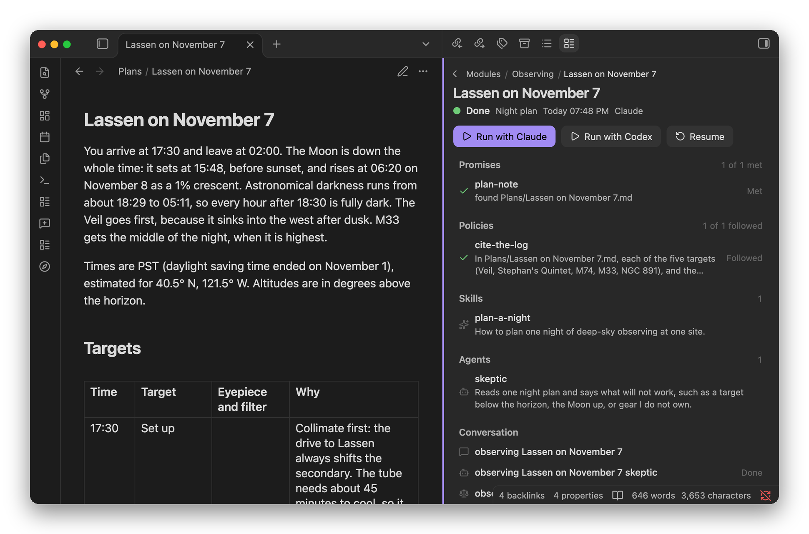

# Yami

Yami is a TypeScript library for building AI agents into Obsidian plugins. Claude Code and Codex are good at work on notes, but a plugin that wants to use them has to start the agent, keep a record of what it did, and decide when the work is done. Yami does this for you. Each piece of agent work is a markdown note in the vault, the agent runs with the user's own Claude Code or Codex setup, and the work ends only when its checks and a review pass.



## How a Session Runs

A session is a note. It says what the work is, which skills and agents it may use, which policies it must follow, and which promises it must deliver. A flow describes one kind of session the way a signature describes a function:

```
agent(input, policies) -> promises
```

When a session runs, the agent takes a turn, and Yami runs the check of each promise that code can verify. When the checks pass, a fresh read-only agent reviews the policies and the promises that need judgment. Anything unmet goes back to the agent as its next prompt, until everything passes or the turns run out. Each step lands in the note, so a person can watch the work, answer the agent's questions, and resume it later.

## Install

A plugin takes the library from a GitHub release, by the URL of its tarball. Pick a version from the [releases](https://github.com/nathanaday/yami/releases) and add it to your plugin's `package.json`:

```json
"dependencies": {
  "yami": "https://github.com/nathanaday/yami/releases/download/yami-0.22.0/yami-0.22.0.tgz"
}
```

Then run `npm install`. The library expects `obsidian`, `esbuild`, `@codemirror/state`, and `@codemirror/view` beside it as peer dependencies.

Two build settings let a plugin import markdown files as text: build with `pluginBuild` from `yami/esbuild`, and add `"types": ["yami/markdown"]` to `tsconfig.json`. A plugin built on Yami runs on the desktop, and its users need Claude Code or Codex installed and signed in.

## Example

A plugin gives `createYami` its agents and its modules:

```ts
import { Plugin } from "obsidian";
import { ClaudeAgent } from "yami/agent/claude";
import { CodexAgent } from "yami/agent/codex";
import { createYami, type ObsidianYami } from "yami/obsidian";
import { Notes } from "./modules/notes";

export default class MyPlugin extends Plugin {
  yami!: ObsidianYami;

  onload() {
    this.yami = createYami(this, {
      agents: [new ClaudeAgent(), new CodexAgent()],
      modules: [new Notes()],
    });
  }
}
```

A module is a class. Its skills, policies, and promises are markdown files beside it, and each flow ties some of them together:

```ts
import { YamiModule } from "yami";
import summarizeSkill from "./skills/summarize/SKILL.md";
import citePolicy from "./policies/cite-sources/POLICY.md";
import writtenPromise from "./promises/summary-written/PROMISE.md";

export class Notes extends YamiModule {
  readonly id = "notes";
  readonly name = "Notes";

  readonly summarize = this.skill(summarizeSkill);
  readonly cite = this.policy(citePolicy);
  readonly written = this.promise(writtenPromise);

  readonly weekly = this.flow({
    name: "weekly-review",
    description: "A summary of the week's notes, with a source for each claim.",
    skills: [this.summarize],
    policies: [this.cite],
    promises: [this.written],
  });
}
```

From this, the plugin gets a command that starts a weekly review, the conversation notes, the commands to run, resume, and stop a session, and the cleanup when it unloads. Every vault also gets a wiki that its agents can search, and a threads module for validated work on repositories; a plugin can turn either off. Only `yami/obsidian` uses the Obsidian API, so a module and its tests run in Node with `yami/testing`.

Users can also add modules without code: a folder of markdown under the vault's `internal/` folder, with one note for the module and a folder for each flow, skill, agent, policy, and promise. Yami picks it up as the files appear and adds a command for each flow.

## Built on Yami

| Repository | What it is |
| --- | --- |
| [obsidian-duet](https://github.com/nathanaday/obsidian-duet) | Duet: Claude Code and Codex in the note editor, editing beside you |
| [yami-wiki](https://github.com/nathanaday/yami-wiki) | Yami Wiki: an LLM wiki in the vault, with cited topics and changes you approve |
| [yami-threads](https://github.com/nathanaday/yami-threads) | Yami Threads: validated work on your repositories, carried from an idea to a close by one note |
| [yami-wiki-agent-plugin](https://github.com/nathanaday/yami-wiki-agent-plugin) | Yami Wiki for Claude Code and Codex: an MCP server with the wiki tools, for agents outside the vault |

## Documentation

- [Library reference](yami/README.md): the modules, the session format, the agent loop, the wiki, and `createYami`
- [Design policy](design.md): the rules the code keeps
- [Releasing](docs/releasing.md): how the library and the plugins are checked and released, and how a plugin gets into a vault
- [Changelog](yami/CHANGELOG.md)

To work on the library itself, run `npm install`, `npm run build`, and `npm test` in `yami/`.
