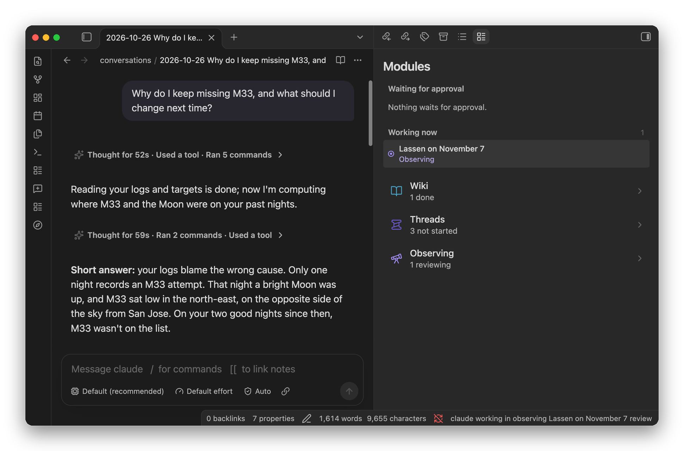
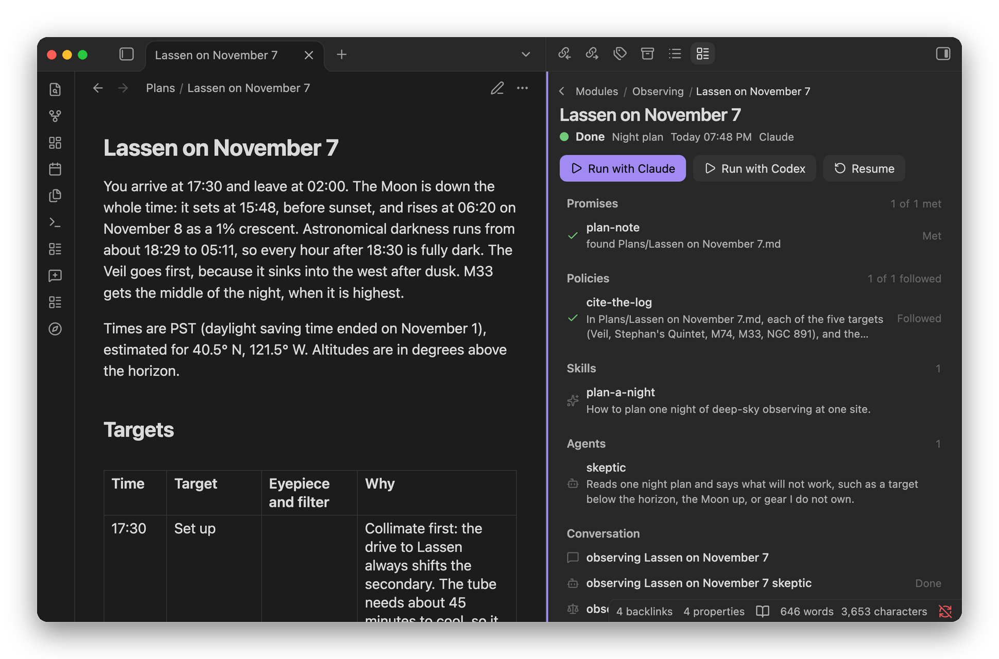
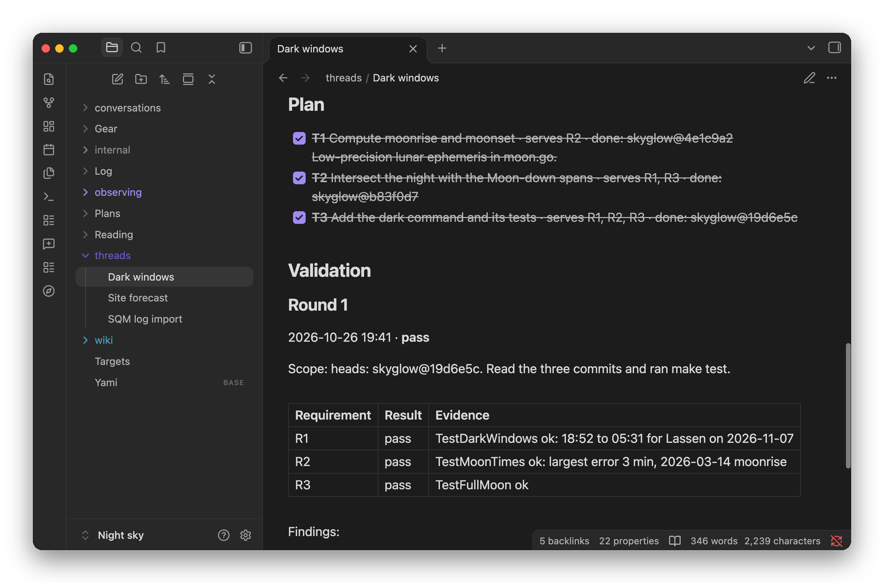
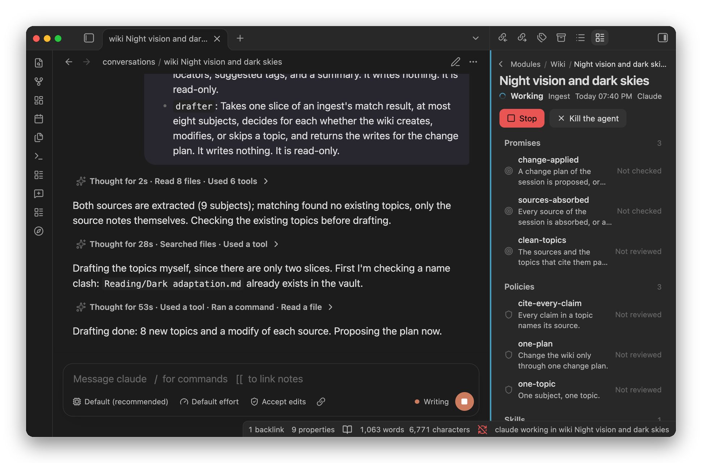
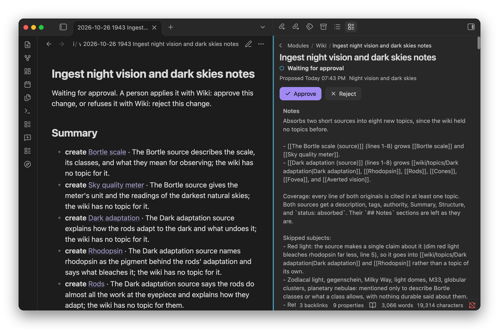

# Yami

Yami is a TypeScript library for building AI agents into Obsidian plugins. It keeps each piece of agent work in a markdown note of your vault, and it runs Claude Code or Codex with your own setup.



Yami replaces [Almagest](https://github.com/nathanaday/almagest). Almagest shipped finished features, such as a librarian and journals. Yami ships the parts to build features like those yourself: a library to build on, and modules you write in markdown. Two modules come built in: a wiki, and threads for work on your repositories.

## How It Works

Yami organizes agent work around one idea: a session is a note. The note says what the work is, which skills and agents it may use, which policies it must follow, and which promises it must deliver. A flow describes one kind of session the way a signature describes a function:

```
agent(input, policies) -> promises
```

When a session runs, the agent takes a turn, Yami checks each promise that code can verify, and a fresh read-only agent reviews the policies and the promises that need judgment. The loop repeats until everything passes or the turns run out. Each step lands in the note, so you can watch the work, answer the agent's questions, and resume it later.

## Build on the Library

A plugin gives Yami its agents and its modules, and Yami adds the rest: the commands, the conversation notes, shared editing, the wiki, and the cleanup when the plugin unloads.

```ts
export default class MyPlugin extends Plugin {
  yami!: ObsidianYami;

  onload() {
    this.yami = createYami(this, {
      agents: [new ClaudeAgent(), new CodexAgent()],
      modules: [new Notes()],
    });
  }
}
```

A module is a class. Its skills, agents, policies, and promises are markdown files beside it, and its flows tie them together:

```ts
export class Notes extends YamiModule {
  readonly id = "notes";
  readonly name = "Notes";

  readonly summarize = this.skill(summarizeSkill);
  readonly cite = this.policy(citePolicy);
  readonly written = this.promise(writtenPromise);

  readonly weekly = this.flow({
    name: "weekly-review",
    description: "A summary of the week's notes, with a source for each claim.",
    skills: [this.summarize],
    policies: [this.cite],
    promises: [this.written],
  });
}
```

A module can also add tools for every agent in the vault, and actions you run on a session, such as publishing it. Only `yami/obsidian` uses the Obsidian API, so a module and its tests run in Node. The [library README](yami/README.md) covers the API.

## Bring Your Own Skills

You can add your own modules without writing code. Each is a folder of markdown under the vault's `internal/` folder: one note for the module, and one folder for each flow, skill, agent, policy, and promise. Yami picks it up as soon as the files appear and adds a command for each flow. If it cannot use a file, it says how to fix it.

```
internal/observing/
  observing.md                      the module
  flows/night-plan/FLOW.md          one kind of session
  skills/plan-a-night/SKILL.md      how to do the work
  agents/skeptic/AGENT.md           a reviewer that runs in a fresh context
  policies/cite-the-log/POLICY.md   a rule the work follows
  promises/plan-note/PROMISE.md     what the work delivers
```

The flow names the rest:

```yaml
---
name: night-plan
description: Plans one night at one site, from the targets I still want and what the log says went wrong.
skills: [plan-a-night]
agents: [skeptic]
policies: [cite-the-log]
promises: [plan-note]
fields:
  site: Lassen
  date: 2026-11-07
---
```

Here is a session of this module after its run: the plan note it promised, the skill and agent it used, and the policy that the review confirmed it followed.



Every skill of every module is also a slash command in any conversation, such as `/observing:plan-a-night`. The built-in threads module takes your own flows too: write them under `internal/threads/`, and their sessions go in `threads/` beside your threads.

## Threads

A thread carries one piece of work on your repositories from an idea to a validated close. Plant one in your own words with `/threads:stub`, and `/threads:run` takes it from there. It writes a spec with checkable requirements and a plan, then does the work with a commit for each task. A fresh read-only agent that did none of the work checks the result against the spec in a validation round. The thread is one note, and Yami reads its phase from what the note holds, so the two always agree.



## A Wiki You Approve

Every Yami vault has a wiki, and every agent can search it, so any conversation can answer from your notes with citations. To teach it something, ingest a file or a folder. The ingest reads each source in chunks with one worker agent per chunk, matches the subjects against the topics you have, and drafts cited topics as one change plan.



Nothing in the wiki changes until you approve the plan. The Yami panel shows what each plan creates, changes, and removes, with a diff for each note. Each approval saves a version before and after, so you can restore any earlier state.



## Conversations in Your Notes

A conversation with Claude Code or Codex is a note with a message box. The agent edits the notes you have open with its own cursor beside yours and leaves a record of each reply and tool call. If you want, it asks before it changes a file or runs a command. Your own Claude Code and Codex setup applies: your instructions, skills, plugins, MCP servers, and permission rules.

## Getting Started

You need Obsidian on the desktop, and Claude Code or Codex installed and signed in.

```sh
git clone https://github.com/nathanaday/yami.git
cd yami/obsidian_plugin
npm install
npm run build
ln -s "$PWD" /path/to/vault/.obsidian/plugins/yami
```

In Obsidian, turn on **Yami** under **Settings → Community plugins**, then run **Open the Yami panel** from the command palette. To build your own plugin on Yami, start from the [library README](yami/README.md).

## The Repository

| Folder | What it holds |
| --- | --- |
| [`yami/`](yami/) | The library |
| [`obsidian_plugin/`](obsidian_plugin/) | The showcase plugin, which puts each part of the library to work |
| [`design.md`](design.md) | The design rules that the code keeps |
